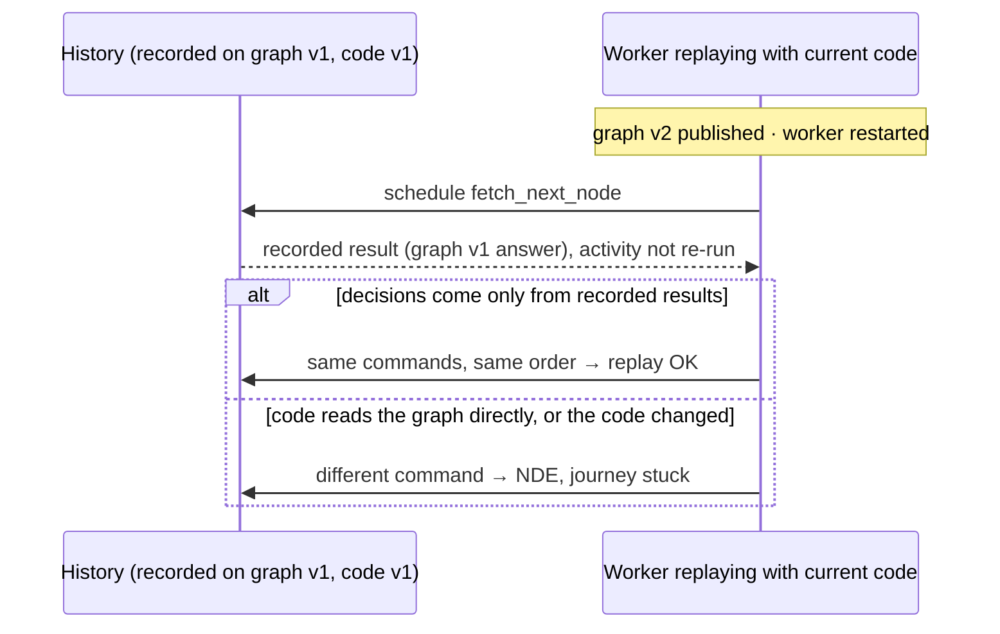
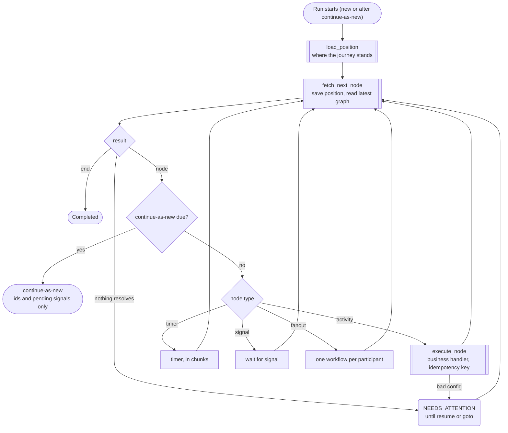
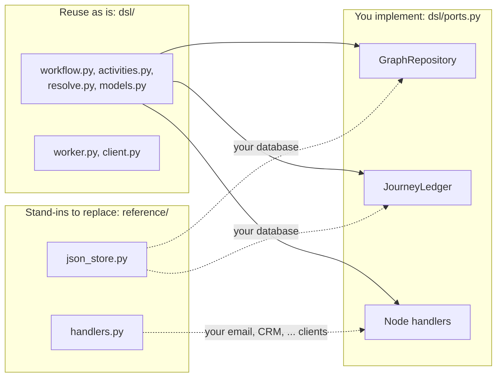

# Replay-safe DSL workflow on Temporal

A reference design for a workflow engine where business users publish a workflow as a JSON graph and one generic Temporal workflow (Python SDK) interprets it. It shows, with tests, which changes can cause a non-determinism error (NDE) on replay, and how the design prevents and handles them. The graph store, ledger and node handlers are stand-ins with the same interfaces as real systems.

## 1. The problem

The workflow starts at the first node, runs it (an activity, a timer or a wait for a signal), fetches the next node from the **latest published graph** through an activity, and repeats. Journeys run for months while users edit the graph and new worker code is deployed.

Temporal rebuilds a workflow by **replaying** its history through the current code. If the code now issues a different command from the recorded one, replay fails with an NDE and the journey is stuck.



## 2. Workflow flow



| Handler | Does |
|---|---|
| Signal `event` | Delivers an external event to a waiting node |
| Signal `nudge` | A waiting node re-reads its definition from the latest graph (send after a publish) |
| Update `goto` | Moves the journey to a node; rejects an unknown or already-run node |
| Update `resume` | Releases a journey parked as `NEEDS_ATTENTION` |
| Query `state` | Status, current node, step, graph version |

## 3. How NDEs are kept out

| Rule | Why |
|---|---|
| The graph reaches the workflow only as the result of `fetch_next_node` | Replay reuses the recorded result, so graph edits can't change past decisions |
| Workflow code reads no globals, caches, files, flags or clock | Those can differ on replay |
| Fixed node types; business kinds are handlers inside one activity | A new business kind needs no workflow change and no patch |
| Any change to the commands the workflow issues goes behind `workflow.patched()` | Old histories take the old path, new journeys the new one |
| Patch lifecycle: patch → deprecate → remove, each after older journeys finish | Removing a patch early is itself an NDE |
| Continue-as-new at node boundaries, after the position is saved | Short histories; patches retire after one run, not one journey |
| `Replayer` over captured histories before every deploy | Catches what the rules missed |
| Ledger of completed steps + idempotency key on every external call | No node runs twice after retries, reset, continue-as-new or restart |

## 4. What causes an NDE (all tested)

Every NDE traces back to one of two causes:

| Cause | Cases reproduced | Fix |
|---|---|---|
| **1. Workflow code reads data outside an activity** | Graph in a global variable (NDE, or a node silently runs again) · graph in a worker-wide cache (NDE once the workflow is evicted or moves worker) · graph file loaded on import (blocked by the sandbox; NDE through a pass-through module) · per-client flag or config read in workflow code | Changing data reaches the workflow only through activity results |
| **2. Workflow code changes the commands it issues** | Extra activity in the loop · timer or child mapped to an activity · activity renamed · two activities merged · continue-as-new condition changed · activity removed from an update handler · child start order changed · search attribute upsert added · patch removed too early · rolling deploy with a patched journey on an old worker (temporary) | `workflow.patched()` (patch → deprecate → remove) plus a replay test before every deploy |

Graph changes alone never cause an NDE. One silent risk: changing the order of `workflow.uuid4()` calls gives no NDE, but the ids change.

| Change | NDE | Fix (tested) |
|---|---|---|
| Graph edited mid-run: add, remove (passed, ahead, current), reorder, reconfigure, retype | **No** | None needed |
| Activity timeout, retry policy, arguments, timer duration | No | None needed |
| Signal handler changed, issuing no commands | No | None needed |
| Histories replayed on another SDK version (1.35.0 → 1.33.0, 12/12) | No | Run the replay gate on every SDK change |
| Graph read from a global or a worker-wide cache | **Yes** (a global can also re-run a node silently) | Read it through an activity |
| Graph file loaded on import | Sandbox blocks it; via a pass-through module, **yes** | Read it through an activity |
| Per-client flag read in workflow code | **Yes** | Read it through an activity |
| Extra activity in the loop · timer mapped to an activity · child mapped to an activity · activity renamed · two activities merged · continue-as-new condition changed · activity removed from an update handler · child start order changed · search attribute upsert added | **Yes** | `workflow.patched()`: old history replays, new journeys take the new path |
| Patch removed before older journeys finished | **Yes** | Deprecate first, remove later |
| Rolling deploy: a patched journey lands on an old worker | Temporary | Continues once a new worker picks it up |
| Order of `workflow.uuid4()` calls changed | No, but ids change silently | Treat as a command change |

**When replay happens:** worker restart, crash or deploy (on each journey's next task), cache eviction, a query on an uncached or closed workflow, and reset. Continue-as-new replays nothing.

## 5. Operations

| Need | Do | Why |
|---|---|---|
| Move journeys to a new node | Update `goto`, optionally with a fresh history (continue-as-new) | Validated, keeps in-flight results and signals. Terminate + start loses both |
| Node fails on bad configuration | Journey parks; publish the fix; Update `resume` | Continues on the latest graph, nothing re-run |
| An NDE reaches production | Roll back → patch → reset → terminate + start | The journey stays Running and stuck, not failed; all four tested |

## 6. Building your own



| Interface | Implement with | Contract |
|---|---|---|
| `GraphRepository` | The store the editor publishes to | `latest(graph_id)`, `get(graph_id, version)`; versions are immutable and kept |
| `JourneyLedger` | One table for positions and completed steps | `position`, `commit_position`, `completed_nodes`, `step_outcome`, `record_step`; each call one transaction |
| Node handlers | Your external clients | `async (NodeCall) -> outcome`; send `call.idempotency_key`; raise `config_error(...)` for bad config |

```python
from dsl.worker import create_worker
from dsl import client as journeys

worker = create_worker(temporal_client, MyGraphRepository(), MyJourneyLedger(),
                       {"send_email": send_email, "update_record": update_record})
await worker.run()

await journeys.start_journey(temporal_client, journey_id, graph_id, task_queue="dsl-interpreter")
await journeys.send_event(temporal_client, journey_id, "form_submitted")
await journeys.nudge(temporal_client, journey_id)               # after a publish
await journeys.move_to_node(temporal_client, journey_id, "nX")  # "accepted" or "rejected"
await journeys.resume(temporal_client, journey_id)              # after a config fix
```

Before every deploy, replay histories sampled from running journeys with `tests/test_golden_replay.py`.

## 7. Try it locally

Requires Python 3.10+ and the [Temporal CLI](https://docs.temporal.io/cli) on `PATH` (or `TEMPORAL_CLI`).

```bash
python3 -m venv .venv
.venv/bin/pip install -e ".[test]"
.venv/bin/python -m pytest                   # all tests, about a minute
.venv/bin/python -m reference.run_worker     # a worker on the stand-ins (./data, local Temporal)
```

```text
dsl/          the engine: workflow, activities, resolve, models, ports, worker, client
reference/    stand-ins to replace: JSON graph store and ledger, example handlers, run_worker
variants/     deliberately unsafe and patched interpreters (tests only)
tests/        test_q1 … test_q9 (one per question), test_more_nde_scenarios, test_business_safety,
              test_integration, test_golden_replay
histories/    captured histories for the replay gate
FINDINGS.md   findings with the test behind each one
SOLUTION_DESIGN.md  full design
```

## 8. Limits

| Limit | Detail |
|---|---|
| Stand-ins | JSON files without locking; production needs a transactional store |
| Graphs | Acyclic; the largest test graph has 6 nodes |
| Waiting journeys | Pick up a changed or removed node when nudged or at a timer chunk |
| Replay frequency | Measured locally, not from production |
