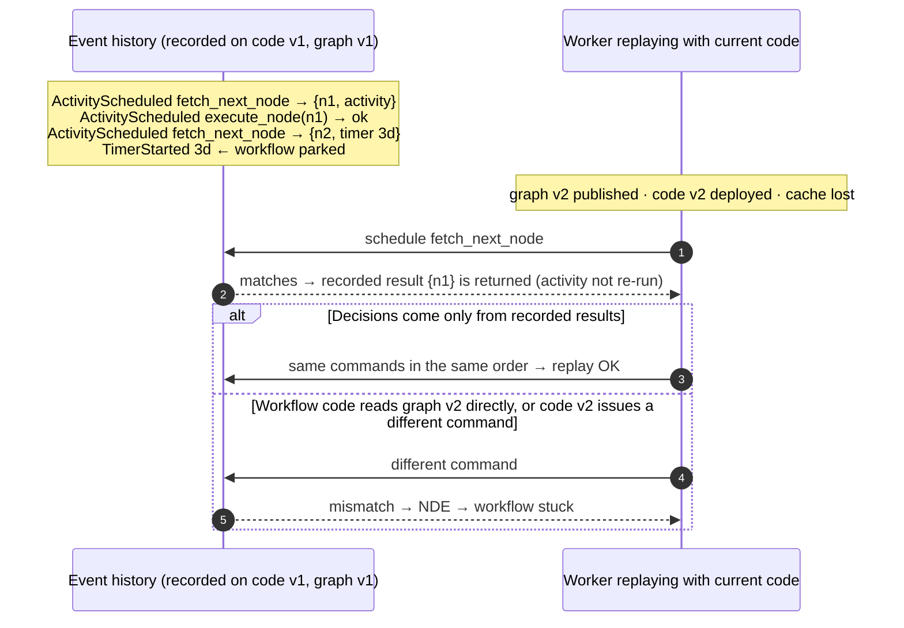
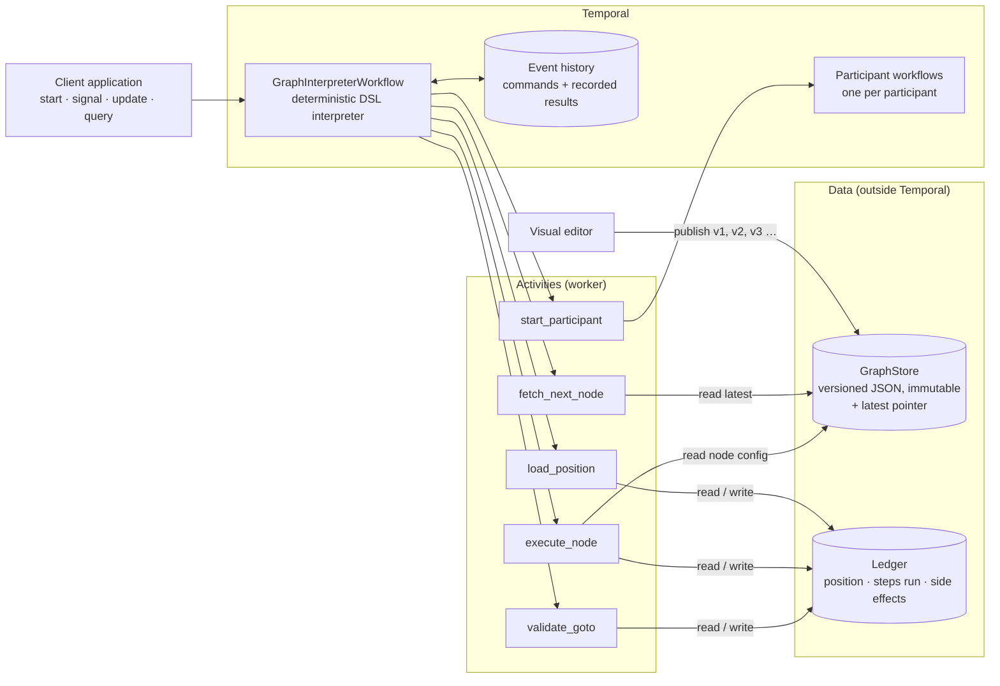
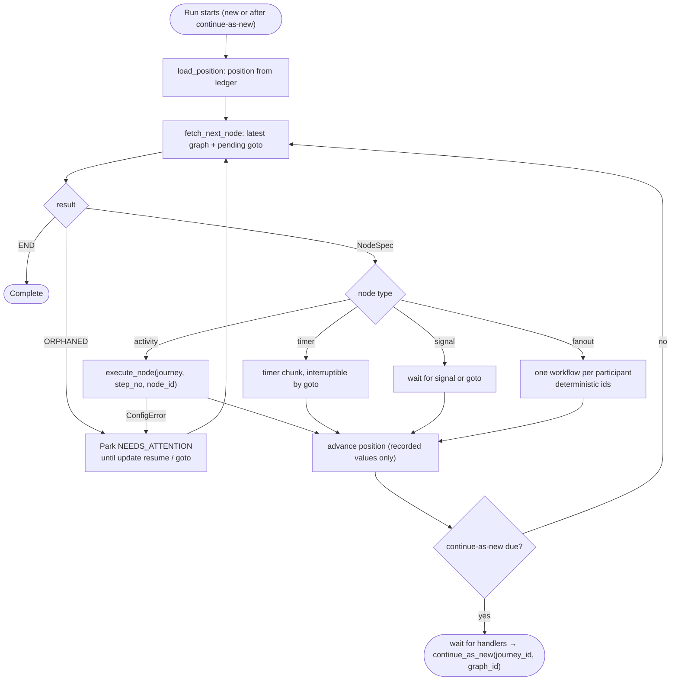
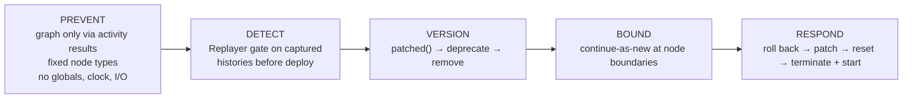
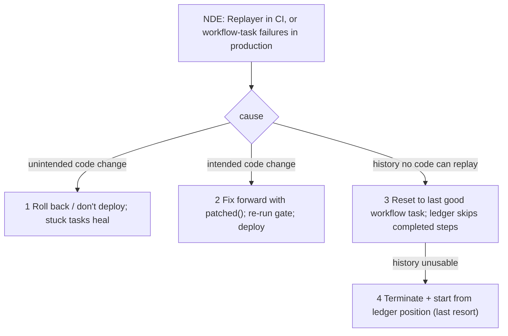

# Solution Design: Replay Safety of a Graph-Driven (DSL) Temporal Workflow

| | |
|---|---|
| Type | Architecture design + proof of concept |
| Status | Implemented; results in `FINDINGS.md` |
| Stack | Python 3.10, Temporal Python SDK `temporalio` 1.35.0, pytest |

---

## 1. Problem statement

### 1.1 Background
A workflow engine is built on Temporal (Python SDK). Business users design workflows as graphs in a visual editor and publish them as JSON. A single, generic Temporal workflow interprets that JSON:
1. It starts at the first node.
2. It runs the node: an activity (send an email, update a record), a timer ("wait 3 days"), or a wait for an external event (signal).
3. It fetches the next node from the latest published graph through an activity, then repeats.

### 1.2 Characteristics
- Workflows are long-running: typically 2–4 months, up to a year.
- A graph has about 70 nodes. At some points, one workflow starts one workflow per participant (10 participants → 10 workflows).
- Users edit a graph while workflows are running (add, remove, reorder or reconfigure nodes) and publish a new version. Every running workflow must then follow the new version from its current position. Old versions are not kept running.
- Nodes that already ran must not run again.
- Workers are deployed as a rolling update (one deployment). Code changes use `workflow.patched()`. Worker Versioning is out of scope.

### 1.3 The problem
Temporal rebuilds a workflow by replaying its event history through the current workflow code. If the code now makes different decisions from the ones recorded (for example, scheduling a different activity at that point), replay fails with a **non-determinism error (NDE)** and the workflow gets stuck.

The workflow's behaviour depends on data (the graph) that changes over time, and its code changes during months-long runs. We need evidence of:
- when replay happens;
- which kinds of change cause an NDE in this design;
- how to make the design safe.



### 1.4 Questions to answer
| Q | Question |
|---|---|
| Q1 | When does replay happen for a long-running workflow in production (worker restart or crash, cache eviction, queries, reset, continue-as-new)? How often is each likely? |
| Q2 | If the next node is fetched through an activity and the graph changes mid-run, is replay of the old history still safe? Hypothesis: yes, because replay uses the recorded activity result. Prove or disprove it. |
| Q3 | Which implementation choices break replay: reading the graph in workflow code (a global, a cache, a file loaded on import), changing how a node type maps to activities, timers or children, changing the interpreter loop? |
| Q4 | Which interpreter changes need `workflow.patched()`, and what is the patch lifecycle (patch, deprecate, remove)? |
| Q5 | Removing a node or activity that some running workflows already executed and others haven't reached: is it safe, and what is required? |
| Q6 | A workflow fails at a node because of bad configuration, the configuration is fixed (the graph may change in between), and the workflow is resumed. Does it continue correctly? |
| Q7 | Where should continue-as-new happen, and does each new run pick up the latest graph? |
| Q8 | Moving selected running workflows to a newly added node: compare a signal or update ("go to node X"), continue-as-new with a start node, and terminate plus start, for replay safety and side effects. |
| Q9 | When replay fails (in CI or production): patch, reset, or terminate and restart? |

---

## 2. What we are building

A small, clean proof of concept of the DSL engine, plus the evidence that answers Q1–Q9.

| Built | Purpose |
|---|---|
| A versioned JSON graph store (files) | The published "program": immutable versions plus a latest pointer |
| A generic interpreter workflow | The DSL interpreter: fetch next node → run → repeat |
| Activities: load position, fetch next node, execute node, validate goto, start participant | The only bridge from the workflow to data and side effects |
| Node types: activity, timer, wait-for-signal, fan-out | The node types in the problem; fan-out covers "children" in Q3 and the per-participant workflows |
| An execution ledger (files) | The record of which nodes ran, so they never run again |
| Deliberately unsafe and versioned interpreter variants (tests only) | To reproduce each NDE |
| Tests on Temporal test environments and `Replayer` | One or more per question: pass on replay or NDE, plus the fix |

Not built: production database, editor UI, multi-tenancy, Worker Versioning, graphs with loops.

---

## 3. Considerations

| Consideration | Effect on the design |
|---|---|
| Runs last months; replay will happen many times on newer code | Every decision must be reproducible from history alone |
| The graph changes under running workflows | The graph may reach workflow code only as recorded activity results |
| Follow the latest version from the current position; old versions not kept | Position is node-id based and is resolved against the latest graph at every hop |
| Nodes never run twice | An idempotent `execute_node` keyed by step, plus a ledger outside Temporal history |
| Rolling deploy, `patched()` only, no Worker Versioning | Old and new code briefly coexist; patches must be few and short-lived |
| About 70 nodes, months of waits, signals and retries | History must be bounded with continue-as-new |
| One workflow per participant | Fan-out ids must be deterministic; the lifecycle of the fanned-out workflows must survive the parent's continue-as-new |
| One namespace and the same workers for all clients; per-client behaviour is application logic | `patched()` is global, so per-client differences must arrive as activity data, never as code branches |
| Removing nodes or activities to reduce cost | Removal from the graph vs. from interpreter code is treated separately |

---

## 4. Solution architecture

### 4.1 Component view


### 4.2 Interpreter loop


### 4.3 Graph JSON (one immutable file per version)
```json
{
  "graph_id": "plan-a", "version": 3, "start": "n1",
  "nodes": {
    "n1": {"type": "activity", "kind": "send_email", "config": {"template": "welcome"}, "next": {"ok": "n2"}},
    "n2": {"type": "timer",    "config": {"seconds": 259200},                         "next": {"fired": "n3"}},
    "n3": {"type": "signal",   "config": {"name": "form_submitted"},                   "next": {"received": "n4"}},
    "n4": {"type": "fanout",   "config": {"participants": ["p1", "p2"], "graph_id": "plan-b"}, "next": {"ok": null}}
  }
}
```
- `type` is the interpreter node type (a fixed set). `kind` is business data handled inside `execute_node`.
- Node ids are stable; position never uses a list index.
- Publishing validates the graph (unique ids, valid `next` targets, known types, a start node) and writes a new version file. Published versions never change.

### 4.4 Ledger
Per journey:
- `position {node_id, step_no, last_outcome, graph_version}`;
- `steps[step_no] {node_id, status, result}`;
- a side-effect log.

`execute_node` is idempotent on `(journey_id, step_no)`. The ledger is the business record of what ran. Temporal history is the execution record. The ledger cannot see a repeat caused by a crash between the external call and the ledger write, so every external call also carries the stable key `journey:step:node`.

### 4.5 Activities
| Activity | Contract |
|---|---|
| `load_position(journey_id)` | First call in every run; position comes from the ledger, not the workflow input |
| `fetch_next_node(journey_id, graph_id, position, goto?)` | Reads the latest graph; returns a complete `NodeSpec {node_id, type, kind, config, graph_version}` or `END` / `ORPHANED` |
| `execute_node(journey_id, step_no, node_id)` | Resolves node config from the latest graph at execution time (a node removed since the fetch runs as fetched), calls the external system with idempotency key `journey:step:node`, writes the ledger with the graph version used. Bad config → non-retryable `ConfigError` |
| `validate_goto(journey_id, graph_id, target)` | Target exists in the latest graph and is not already completed |
| `start_participant(journey_id, participant)` | Starts a top-level workflow `{journey_id}:{participant}`; "already started" counts as done |

### 4.6 Next-node resolution (follow latest, never rerun)
1. No position → `start`.
2. A valid goto is pending → the goto target.
3. Current node exists in the latest graph → `next[last_outcome]`.
4. Current node was removed → walk `next` in the journey's previous version until reaching a node that exists in the latest graph.
5. Skip nodes the ledger marks completed.
6. Nothing resolves → `ORPHANED` → park as `NEEDS_ATTENTION`.

### 4.7 Node types → Temporal commands, and handlers
| Node type | Command |
|---|---|
| `activity` | `execute_activity("execute_node", journey_id, step_no, node_id)` |
| `timer` | `wait_condition(goto or nudge, timeout=min(remaining, chunk))`; deadline from config; chunked so it can continue-as-new |
| `signal` | `wait_condition(signal received or goto or nudge)` |
| `fanout` | Child workflow per participant (deterministic ids). Compared in tests with `start_participant`. |

| Handler | Behaviour |
|---|---|
| signal `event(name, payload)` | Records the event |
| signal `nudge()` | A waiting node re-fetches its definition from the latest graph (sent after a publish) |
| signal `goto_signal(target)` | Unvalidated goto; exists only to compare with the Update in Q8 |
| update `goto(target)` | Validates through `validate_goto`; accepts or rejects; applied at the next node boundary |
| update `resume()` | Releases `NEEDS_ATTENTION` |
| query `state()` | Read-only position and status |

---

## 5. Determinism: how it is handled



### 5.1 When replay happens (Q1)
| Trigger | What replays | Expected frequency |
|---|---|---|
| Worker restart, crash, rolling deploy | Full history, on the workflow's next task | After every deploy, each running workflow replays on its next task |
| Cache eviction | Full history | Most wake-ups once running workflows exceed the worker cache (`max_cached_workflows`, SDK default 1000) |
| Sticky queue timeout | Full history on another worker | When the cached worker doesn't take the task within the timeout (SDK default 10 s) |
| Query | Full history if not cached | Every query on an uncached workflow; always for a closed one |
| Reset | History up to the reset point | Only when an operator resets |
| Continue-as-new | Nothing from the old run | Never; it bounds every later replay |

In this system replay is routine. Every running workflow replays its whole current run on newer code.

### 5.2 Interpreter rules
| # | Rule |
|---|---|
| D1 | The graph reaches workflow code only through activity results, and each result is complete (type, config, next) |
| D2 | Workflow code decides only from: input, activity/child/timer results, signals/updates, `workflow.now()`, `workflow.uuid4()`, `workflow.random()`. Never globals, module state, files, env, process caches, system clock, `random`, or I/O |
| D3 | Fixed node types; business kinds live inside `execute_node`, never as new Temporal activity types |
| D4 | Any change to which commands are issued, or in what order, goes behind `workflow.patched()` |
| D5 | Position comes from the ledger; continue-as-new input carries ids and unprocessed signals only |
| D6 | Payload schema changes are additive only |
| D7 | Per-client behaviour arrives as activity data, never as a flag read in workflow code |
| D8 | Handlers only change state; the loop acts at node boundaries |
| D9 | Business errors park the workflow (`NEEDS_ATTENTION`); they don't fail it |
| D10 | Continue-as-new only at a node boundary, with nothing in flight and all handlers finished |
| D11 | Every deploy passes a `Replayer` gate over captured histories |

### 5.3 Which changes need a patch (Q2–Q4)
| Change | NDE without patch | Action |
|---|---|---|
| Graph JSON: add, remove, reorder, reconfigure | No | Publish a new version |
| Business `kind` handler inside `execute_node` | No | Deploy |
| Interpreter: add, remove or reorder an activity, timer or child; change node-type → command mapping; change continue-as-new condition | Yes | `patched()` |
| Graph read in workflow code (global, cache, import-time file) | Yes | Forbidden (D1, D2) |
| Activity args, timeouts, retry policy, timer duration | No (old histories keep old values) | Deploy; note the behaviour difference |

**Patch lifecycle:**
1. **Deploy 1:** `if workflow.patched("x"): new else: old`.
2. When every run started before deploy 1 has closed or continued-as-new → **Deploy 2:** `workflow.deprecate_patch("x")`, new code only.
3. When every run started before deploy 2 has closed or continued-as-new → **Deploy 3:** remove the call.

Continue-as-new keeps each wait to about one run's length. During a rolling deploy, a workflow already on the new branch that lands on an old worker gets a temporary NDE; it retries and heals on a new worker.

### 5.4 Continue-as-new (Q7)
- **Where:** at a node boundary, right after `fetch_next_node` has committed the position to the ledger; at a timer chunk boundary; on a `goto` with `mode=continue_as_new`.
- **When:** `workflow.info().is_continue_as_new_suggested()`, N hops in the run, or timer chunk end.
- **New run:** `load_position` → `fetch_next_node`. It gets the latest graph and runs on the latest worker code.
- **Fan-out:** the parent close policy applies to child workflows when the parent continues-as-new. Workflows started by `start_participant` are independent.

### 5.5 Moving workflows to a node (Q8)
| | A. Signal / Update "goto X" | B. Continue-as-new with start X | C. Terminate + start from X |
|---|---|---|---|
| Replay-safe | Yes (recorded) | Yes (new history) | Yes (new history) |
| Trigger | Client sends it directly | Needs A to tell the workflow | Client terminates, then starts |
| Validation | Update: synchronous accept or reject | Via A | None |
| In-flight work | Applied at node boundary | Applied at node boundary | Cut: side effect may happen, result lost |
| Signals in transit | Kept | Kept | Lost |
| No rerun | Ledger | Ledger | Ledger only |
| History | Continuous | Linked runs | Broken |

Recommendation (confirmed by the Q8 tests): **A as an Update**, optionally followed by continue-as-new. C is a last resort only.

### 5.6 Recovery (Q6) and removal (Q5)
**Bad config:**
1. `ConfigError` → the workflow parks as `NEEDS_ATTENTION`.
2. The fix is published.
3. `resume` update → re-fetch on the latest graph → `execute_node` with the same `step_no`.
- If the workflow already closed: reset to before that node's `fetch_next_node`.
- Config is never passed as activity input, because retries reuse the original input.

**Removal:**
- **Graph node:** safe; no patch. Workflows on the node are handled by resolution rule 4.
- **Business kind:** safe; stop publishing graphs that use it first.
- **Interpreter activity** (including merging fetch + execute to reduce Actions): patch lifecycle, and the activity stays registered until nothing has it in flight.

### 5.7 When an NDE happens anyway (Q9): reproduce, then handle
An NDE fails the workflow task, not the workflow. The workflow stays Running, retries the task, and makes no progress (stuck).

**Reproduce:**
| Step | Action | Evidence |
|---|---|---|
| R1 | Start a journey on worker code v1. It runs `n1` (side effect recorded) and parks on a signal node. | Ledger: `n1` completed once |
| R2 | Stop the v1 worker. Start a worker with incompatible code v2: an extra activity before `fetch_next_node`, not patched. | — |
| R3 | Send the signal. The v2 worker replays the history and diverges at the first command. | History: `WorkflowTaskFailed` (non-determinism). Status: Running. Ledger unchanged: stuck |
| R4 | Replay the same captured history offline with `Replayer` on v2. | `Replayer` raises the NDE: CI would have blocked the deploy |

**Handle** (each remedy starts from the stuck state of R3):
| Remedy | Action | Expected evidence |
|---|---|---|
| H1 Roll back | Replace the v2 worker with v1 | Task retry succeeds; journey completes; `n1` not rerun |
| H2 Patch | Deploy v2 with the change behind `workflow.patched()` | Old history takes the old branch and completes; a new journey takes the new branch; `Replayer` passes both histories |
| H3 Reset | Reset to a workflow task before the divergence, on v2 | Journey re-executes from the reset point; ledger returns the stored result for `n1`, so the side effect is not repeated |
| H4 Terminate + start | Terminate; start a new run for the same journey on v2 | `load_position` resumes from the ledger; no rerun; a signal sent between terminate and start is lost |

Order of use: **H1 → H2 → H3 → H4**.


---

## 6. Decisions
| Decision | Rationale |
|---|---|
| Graph only through activity results | Replay uses recorded results, so graph edits can't change past decisions |
| Fixed node types; business kinds inside one activity | New or changed business behaviour needs no workflow code change and no patch |
| Node-id positions resolved against the latest graph every hop | Follows the new version from the current position; old versions don't keep running |
| Ledger outside Temporal, idempotent `execute_node` | No rerun across reset, continue-as-new, goto, terminate + start |
| Continue-as-new at node boundaries | Bounded history and short-lived patches |
| Update for "go to node X" | Recorded, validated, keeps history and signals |
| Park on business errors | Recovery without reset |
| `temporalio` 1.35.0 | Newest release supporting the available Python 3.10 |

---

## 7. What we prove: tests
Each test reproduces the scenario, shows **pass on replay** or **NDE**, and shows the fix where one exists. The observed results are recorded in `FINDINGS.md`.

| Q | Test | Scenario | Expected |
|---|---|---|---|
| Q1 | `test_q1_replay_triggers` | Replay counter across worker restart, cache disabled, query (uncached / closed), reset, continue-as-new | Replay in each except continue-as-new |
| Q2 | `test_q2_graph_changes` | Park on v1; publish v2 with add, remove (passed / ahead / current), reorder, reconfigure; `Replayer` + live continue | Replay passes; follows v2; no rerun |
| Q3 | `test_q3_unsafe_patterns` | Graph in a global / file on import / process cache; timer → activity; activity renamed; extra loop activity; child → activity fan-out; per-client flag in code; `uuid4` order. Control: timer duration, args, retry policy | NDE, fixed by the safe interpreter or `patched()`; `uuid4`: silent id drift; control: passes |
| Q4 | `test_q4_patch_lifecycle` | Code {v1, v2 unpatched, v2 patched, v3 deprecated, v4 removed} × histories {v1, v2, v3}; rolling-deploy case | Pass/NDE grid |
| Q5 | `test_q5_removal` | Graph node removed (past / ahead / current); activity unregistered while in flight; interpreter branch removed; fetch + execute merged | Graph removal safe; code removal needs patch + registration kept |
| Q6 | `test_q6_recovery` | Bad config → fix + graph change → resume; config-as-input retry; reset before vs after fetch | Continues on latest; replay passes; no rerun |
| Q7 | `test_q7_continue_as_new` | Continue-as-new by hops and timer chunk; v2 published mid-run; signal across continue-as-new; child vs started participants | New run on v2 and new code; bounded history; no lost signal |
| Q8 | `test_q8_move_to_node` | Update, signal, continue-as-new with start, terminate + start, with in-flight activity and pending signal | Replay safety and side effects per option |
| Q9 | `test_q9_nde_response` | Reproduce R1–R4 (live NDE after incompatible deploy; `Replayer` catches it offline), then handle with H1 roll back, H2 patch, H3 reset, H4 terminate + start | Stuck, not failed; each remedy completes the journey without rerunning `n1` (H4 loses the in-transit signal) |
| — | `test_golden_replay` | Every captured history against current code | Pass (CI gate) |

Environments: `WorkflowEnvironment.start_time_skipping()` for timers; `WorkflowEnvironment.start_local()` for restart, query and reset; `Replayer` for offline replay.

---

## 8. Deliverables
| Expected deliverable | Produced as |
|---|---|
| POC repository with runnable tests, one or more per question | This repository; `pytest` runs all of §7 |
| Findings document (2–3 pages): change type × replay-safe × what to do; when replay happens; interpreter do's and don'ts; recommended approach for moving workflows to a new node | `FINDINGS.md`, filled from test results |

Repository layout:
```
SOLUTION_DESIGN.md   this document
FINDINGS.md          findings (from test evidence)
README.md            how to run
pyproject.toml
dsl/                 the engine: ports.py · workflow.py · activities.py · resolve.py · models.py · worker.py · client.py
reference/           stand-ins to replace: json_store.py · handlers.py · run_worker.py
variants/            unsafe and patched interpreters (tests only)
tests/               conftest.py · test_q1 … test_q9 · test_more_nde_scenarios.py · test_business_safety.py ·
                     test_integration.py · test_golden_replay.py
histories/           captured histories for the replay gate
```
